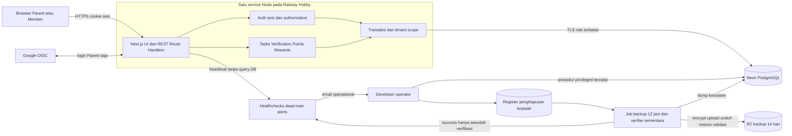

# Architecture Draft A1 — household-task-management

Status: **DRAFT — belum approved**. Tanggal: 23 November 2026 (Asia/Jakarta). Otorisasi pengguna: menyusun A1 dan ADR draft untuk review; bukan izin implementasi, migration, pembelian atau deployment. Architecture tetap `in_progress`; implementation/QA/release `pending`.

## 1. Baseline dan cara membaca

Baseline aktif adalah [PRODUCT D2](PRODUCT.md) + [CR-N06-001 P1 approved/applied](workflow/CR-N06-001.md), [addendum AC N-06](workflow/CR-N06-001-AC-ADDENDUM.md), dan [UX R3 approved](ux/approval.md). Keputusan pengguna tetap di [architecture-user-decisions.md](../.workflow/intake/architecture-user-decisions.md); pilihan teknis di A1/ADR adalah rekomendasi agen yang menunggu approval.

| Artefak | SHA-256 terverifikasi sebelum penyusunan |
| --- | --- |
| PRODUCT D2 + CR | `ab1832277cd3a8314244b285727e46b74a9e93d5817013e3b9dad1f92a6388fa` |
| Approval PRODUCT D2 historis | `e0875ad15d27f8a8720cebd4954ba6b33699694f69762f078a0dda1746678482` |
| CR-N06-001 P1 | `afec792b93c9d17d33d71cba5c337754e1a4fdd6c9f8ab2d2aea1bae8323e0b4` |
| Addendum AC N-06 | `848afc96ed8f922ec076b20a135faa55f02ba42321524f6d00a63a73535c2b65` |
| Prototype UX R3 | `512aa9f01784a0a7fb0b69e458abaa892740d73acbbc887725c9ed9ddcb1328b` |
| Keputusan pengguna | `c702936189c8352f212f3f1feb5b950f818b14be62a254dc3fb02c0e80d29e9f` |

Pernyataan menunggu approval pada dokumen review UX lama adalah riwayat; approval final dan manifest R3 menjadi rujukan terkini. A1 tidak mengubah artefak baseline. Tidak ada klaim benchmark, transaksi, auth atau restore produksi sudah diuji.

Lampiran normatif draft: [data dan transaksi](architecture/A1-data-transactions.md), [API dan autentikasi](architecture/A1-api-security.md), [biaya dan operasional](architecture/A1-operations-cost.md), [traceability dan verifikasi](architecture/A1-verification-traceability.md). Seluruh lampiran berstatus draft bersama A1.

## 2. Constraints dan overview

Pilot satu keluarga, <=10 anggota, <=100 tugas aktif, <=10.000 aktivitas. Web online, perangkat pribadi, bahasa Indonesia, layout360/1280px. Target daftar tugas dan halaman pertama riwayat <=3detik pada >=19/20 pengukuran. Tidak mengasumsikan pertumbuhan publik, offline, foto, pembayaran atau analytics eksternal.

Satu aplikasi full-stack menyajikan UI dan REST API same-origin. Database adalah sumber kebenaran. Seluruh perubahan bisnis per keluarga diserialkan dengan lock row keluarga dalam transaksi singkat; read tidak mengambil lock tersebut. Hal ini sengaja lebih sederhana daripada protokol locking banyak entitas untuk sepuluh pengguna.

Job dan monitor mendukung N-06/N-07; bukan broker atau service bisnis tambahan. Tidak ada Redis, message broker, microservices, Kubernetes atau websocket service. Recurring occurrence dibentuk di transaksi penyelesaian, bukan cron. Tidak ada database pada filesystem app ephemeral.

## 3. Stack yang direkomendasikan

| Bagian | Rekomendasi draft | Alternatif dan alasan |
| --- | --- | --- |
| Runtime | TypeScript strict, Node.js24 LTS patch keamanan terbaru yang kompatibel | Node26 LTS dapat dievaluasi kemudian; memilih major konservatif mengurangi perubahan serentak. Pin versi/lockfile saat implementasi, jangan mengambil latest tanpa review. |
| UI/server | Next.js16 App Router + React + CSS mengikuti R3; REST Route Handlers pada runtime Node | Fastify + React/Vite ringan tetapi perlu merakit build/auth/rendering dua bagian; SvelteKit layak tetapi belum ada preferensi maintainer. Next satu build/deploy dan didukung Node hosting. Jangan menggunakan Edge runtime untuk SQL/Argon2. |
| Persistence | PostgreSQL18 pada Neon Free; SQL eksplisit berparameter via `pg`, pool kecil | SQLite cocok kapasitas pilot dan transaksi, tetapi memerlukan volume persisten serta backup yang terikat host. PostgreSQL memberi FK, partial unique indexes dan RLS; bukan dipilih karena SQLite tidak bisa menjaga integritas. Prisma/ORM tidak wajib, agar boundary transaksi dan constraint terlihat. |
| Validasi | Zod pada API, DTO keluaran terbatas | Validasi manual lebih sedikit dependency tetapi lebih mudah menyimpang; validator bukan pengganti DB constraints. |
| Auth | `openid-client` untuk Google; Argon2id untuk passphrase; opaque DB-backed session | Password/magic link Parent menambah recovery/email aplikasi. Managed auth lain menambah ketergantungan dan mungkin biaya; tidak diperlukan untuk pilot kecil. Tidak merancang protokol kriptografi sendiri. |
| Waktu | Temporal melalui `@js-temporal/polyfill` yang dipin jika native belum kompatibel | Penambahan milidetik24jam keliru untuk hari lokal/DST. Abstraksi tunggal menghindari campuran aturan server/browser. |
| Tests kelak | Vitest, PostgreSQL18 isolated integration, Playwright + axe; lint/typecheck/build | SQLite test substitute tidak membuktikan locking/partial index/RLS PostgreSQL. Container test bersifat lokal/CI, bukan infrastruktur produksi baru. |

Versi patch dan kompatibilitas dependency harus diperiksa sebelum instalasi kelak. Belum ada package manifest, kode aplikasi, DDL atau migration yang dibuat. Sumber utama: [Node releases](https://github.com/nodejs/Release), [Next Node deployment](https://nextjs.org/docs/app/getting-started/deploying), [Next authentication](https://nextjs.org/docs/app/guides/authentication), [openid-client](https://github.com/panva/openid-client), [pg transactions](https://node-postgres.com/features/transactions), [Temporal](https://tc39.es/proposal-temporal/docs/zoneddatetime.html).

## 4. Topology dan biaya

Rekomendasi bersyarat: satu app Railway Hobby selalu aktif, PostgreSQL18 Neon Free, satu job backup Railway yang berhenti setelah selesai, R2 Standard untuk salinan terenkripsi dan register penghapusan terpisah, Healthchecks free untuk dua heartbeat. Region app/DB dipilih sama atau terdekat, utamakan Singapore bila keduanya tersedia pada plan yang dipilih; tidak mengklaim lokasi backup/log terbatas region tersebut.

Estimasi all-in skenario dasar **Rp121.500/bulan**, skenario tekanan **Rp162.900/bulan**, menggunakan asumsi kurs perencanaan18.000/USD, allowance pajak12% dan spread kartu3% sebagai buffer perencanaan, bukan tarif pajak aktual atau quotation. Rincian seluruh komponen dan formula ada pada [lampiran biaya](architecture/A1-operations-cost.md). Skenario dasar memerlukan penggunaan app rendah yang belum diukur, kuota free-tier cukup, domain gratis memenuhi Google, dan job restore pendek. Jadi target150ribu **belum terbukti**, bukan harga flat atau komitmen pembelian.

Jika estimasi aktual >150ribu, ajukan approval sebelum memilih/upgrade; tidak ada auto-upgrade. Jika hard spending stop atau quota menyebabkan berhenti, itu risiko availability yang harus ditinjau, bukan pemenuhan RTO. Paket app+Postgres berbayar penuh sekitar >234ribu sebelum biaya lain menjadi alternatif berbiaya lebih tinggi, bukan fallback yang otomatis diizinkan. Free app dengan cold start panjang tidak menjadi pilihan default untuk N-05.

## 5. Boundary, konsistensi dan timezone

Module logical: Identity/Sessions, Family/Areas, Tasks/Occurrences, Submissions/Completions, Points, Rewards, History, Operations. Mereka adalah modul dalam satu proses, bukan services terpisah. Repository menerima tenant context dari sesi, tidak menerima tenant terotorisasi dari request body. Semua bisnis write melalui unit-of-work yang sama; tidak ada jalur UI/server action yang melewati service authorization.

RLS per keluarga menjadi lapisan tambahan pada business tables; runtime bukan table owner/superuser/BYPASSRLS. Auth bootstrap terpisah di schema privat server-only; tidak ada akses database langsung dari browser. Detail model, unique keys, correction generations dan transaksi ada di lampiran data.

Waktu diterima sistem berasal dari server/DB setelah lock didapat, bukan jam perangkat. Simpan instants UTC (`timestamptz`) dan IANA timezone keluarga yang tetap setelah setup. Tenggat awal menerima tanggal/jam lokal + timezone, server memvalidasi round-trip. Jika jam lokal ambigu/tidak ada karena DST, kembalikan validation error untuk memilih waktu valid; jangan menebak offset input.

Recurring: ubah `effective_at` ke timezone keluarga, tambah `interval_days` sebagai **hari kalender lokal**, simpan instant hasil. Usulan kebijakan DST untuk hasil recurring yang tidak ada/ambigu: Temporal compatible (gap maju sebesar gap, overlap pilih occurrence lebih awal), catat offset dan due lokal hasil. Ini keputusan teknis draft yang memerlukan review; jika dianggap perubahan perilaku produk, ajukan change control sebelum diterapkan. Untuk Asia/Jakarta contoh D2 tetap: disetujui3Des08.00 +7hari =>10Des08.00. Tidak selalu setara tambah7x24jam. Waktu pengajuan/persetujuan ditampilkan terpisah.

## 6. Reliability dan keamanan

Gangguan biasa mempertahankan seluruh transaksi committed. Disaster hanya kehilangan permanen storage utama: pilih backup terakhir yang tersedia **dan lolos verifikasi restore**, selisih titik data dengan insiden <=24jam. Jangan menyebut job terjadwal sebagai bukti RPO. Backup12jam, retensi14hari, log7hari, uji restore per backup otomatis dan drill operator bulanan diusulkan dalam lampiran operasi.

Target RTO24jam dihitung dari layanan terhenti sampai layak dibuka kembali, mencakup deteksi/respons manusia/validasi. Risiko >24jam ketika operator tunggal tidak tersedia diterima **khusus pilot**, tetap terpisah dari N-06 dan wajib ditinjau sebelum ekspansi. Tidak mencakup penerimaan pelampauan RPO, kebocoran data, kegagalan integritas atau penurunan performa.

Model ancaman, kontrol sesi, recovery Parent, daftar API Must dan prosedur verifikasi operator ada di [API/security](architecture/A1-api-security.md). Restore dan deletion register mencegah data yang sudah dihapus muncul kembali; tidak ada fitur hapus sejarah individual atau refund reward baru.

## 7. ADR draft dan keputusan review

| ADR | Rekomendasi yang diajukan |
| --- | --- |
| [ADR-001](architecture/adr/ADR-001-application-stack.md) | Monolit full-stack TypeScript/Next/Node |
| [ADR-002](architecture/adr/ADR-002-storage-tenancy.md) | PostgreSQL managed, composite FK, tenant RLS |
| [ADR-003](architecture/adr/ADR-003-transactions-ledger.md) | Family-row serialization, ledger append-only dan idempotency |
| [ADR-004](architecture/adr/ADR-004-authentication-recovery.md) | Google OIDC, credential anak lokal, opaque session dan recovery operator |
| [ADR-005](architecture/adr/ADR-005-hosting-budget.md) | Railway/Neon free bersyarat, total biaya dan fallback berizin |
| [ADR-006](architecture/adr/ADR-006-recovery-privacy-time.md) | Verified backup, deletion register dan RTO target |
| [ADR-007](architecture/adr/ADR-007-timezone.md) | Hari kalender lokal dan kebijakan DST |

Semua ADR **proposed**, tanpa reviewer approval. Tidak ada keputusan approved yang ditulis ke state. Risiko dan gate review dirinci pada lampiran verifikasi: kelayakan biaya/kuota, cold starts/performa, OAuth subdomain, recovery operator, DST, verifikasi backup, cakupan retention provider, dan fallback tanpa persetujuan biaya tambahan. A1 dapat direview sekarang; kelayakan pilot belum dibuktikan.

## 8. Verifikasi dokumen

[Laporan pemeriksaan A1](architecture/A1-document-validation.md) mencatat pemeriksaan baseline, cakupan F/N/API, link dan workflow yang benar-benar dijalankan. Matriks [traceability](architecture/A1-verification-traceability.md) memetakan seluruh F-01–F-17, N-01–N-08, UX R3 dan CR ke komponen serta rencana acceptance test. Rencana uji belum merupakan hasil. STOP setelah laporan; tunggu review pengguna tanpa implementasi/deployment atau transisi completed/approved.
