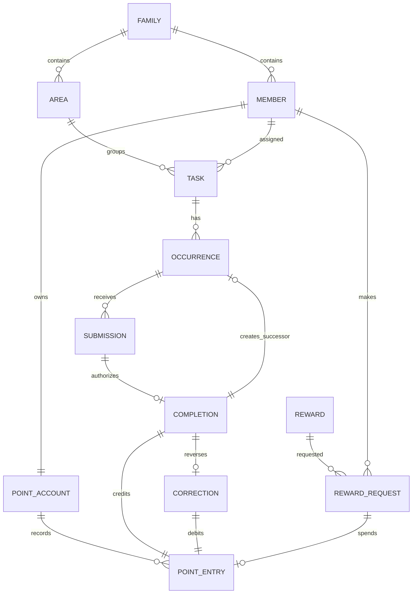

# A1 — model data, tenancy dan transaksi

Status: **DRAFT — belum approved**, bagian [Architecture A1](../ARCHITECTURE-A1.md). Ini spesifikasi konseptual, bukan DDL atau migration.

## Model dan relasi

Semua entity bisnis memakai UUID acak dan `family_id` wajib, PK `id` serta unique `(family_id,id)` untuk target composite FK. Timestamp UTC, poin integer bertanda, versi integer meningkat. Satu identitas anggota hanya milik satu keluarga untuk MVP. Tidak meminta tanggal lahir/foto/email anak.

| Entity | Field penting dan relasi |
| --- | --- |
| `families` | id, display_name, timezone IANA nullable sebelum setup lalu immutable, setup_completed_at, status active/deleting, business_version; row juga menjadi mutex bisnis keluarga |
| `members` | family FK, display_name, role Parent/Member, active, version, auth_version, created_at; tidak dihapus lewat UI |
| `areas` | family FK, name, archived_at, version; unique nama bukan requirement, jangan menambah pembatasan bisnis diam-diam |
| `tasks` | family FK, area/member composite FK, title, points>=0, needs_verification, interval_days nullable atau>=1, archived_at, version; due awal ada di occurrence |
| `occurrences` | task composite FK, due_at, due_local/offset hasil hitung, status open/pending/completed/retired, predecessor_completion_id nullable composite FK, current_completion_id nullable; retired berarti successor dinonaktifkan karena koreksi, bukan dihapus |
| `submissions` | occurrence/member composite FK, status pending/rejected/approved/direct/cancelled, submitted_at, rules_snapshot {points, assignee_id, needs_verification, interval_days, task_version}, decision_actor/time/reason, self_verified flag; histori rejection tetap ada |
| `completions` | submission/occurrence composite FK, effective_at, credited_points snapshot, cancelled_at nullable; credit entry ditemukan melalui unique source FK ledger, bukan back-reference siklis. Baris baru pada penyelesaian ulang setelah koreksi, bukan menimpa completion lama |
| `corrections` | completion composite FK, reason, actor, corrected_at, original_credit_entry_id FK ke ledger yang sudah ada, preview_version; debit ditemukan melalui unique source FK ledger, satu reversal per completion |
| `point_accounts` | satu per member; tidak menyimpan balance utama. Ada row stabil untuk relasi dan version; akun Parent juga ada jika assignee |
| `point_entries` | account FK, kind credit/correction_debit/reward_debit, signed amount, source completion/correction/reward_request, actor/time; satu source typed FK yang sesuai kind, yang lain NULL; append-only untuk operasi bisnis |
| `rewards` | family FK, name, cost>0 integer, active, version |
| `reward_requests` | reward/member composite FK, cost_snapshot>0, name_snapshot, requested_at, status pending/approved/rejected, decided_by/time/reason; debit ditemukan melalui unique source FK ledger, tidak ada reserve saldo, stok atau status fulfilled |
| `business_events` | family FK, event_type, entity_id terikat tipe, actor/assignee, submission/decision/correction timestamps, reason, source_action_id; projection histori terstruktur tanpa secrets; ditulis dalam transaksi sumber |
| `commands` | family/actor FKs, operation, client_key, payload_digest, outcome applied/refused dan original entity/result/error code reference, completed_at; simpan hasil domain minimum, bukan arbitrary HTTP payload atau rahasia; retention selama entity/histori keluarga aktif untuk replay. Untuk mutasi yang membawa passphrase, fingerprint berupa HMAC dengan secret server khusus, bukan hash publik yang memudahkan tebakan offline |

Auth schema server-only: `oauth_identities` (issuer,sub -> Parent member), `member_credentials` (member, login_handle global unik, argon2 hash), `sessions` (token_hash, family/member, auth_version, issued/idle/absolute/revoked), `oauth_attempts` (state hash, PKCE verifier terenkripsi/secret store, nonce, TTL10menit), `recovery_codes` (member, code_hash, consumed/revoked), `recovery_requests` (member, new issuer/sub pending proof, expiry, operator approval id), `login_attempt_buckets` (hashed handle/IP prefix, attempts, expiry). Tidak dikembalikan lewat business API. Recovery code tidak pernah ada dalam commands/business_events.

## Constraint yang harus dibuktikan

| ID | Constraint konseptual |
| --- | --- |
| D-01 | Semua composite FK membawa family_id: task-area/assignee, occurrence-task, submission-occurrence/member, completion-submission/occurrence, correction-completion, ledger-account/source, request-reward/member dan actor. FK tunggal id tidak cukup. |
| D-02 | Partial unique `(family_id,occurrence_id)` pada submissions dengan status pending. Dua tab memperoleh pending yang sama, meski client_key berbeda. |
| D-03 | Partial unique `(family_id,occurrence_id)` pada completions dengan cancelled_at NULL. Unique submission_id pada completions. Bukan unique seluruh kredit sepanjang umur occurrence. |
| D-04 | Unique predecessor_completion_id yang tidak NULL pada successor occurrences; satu successor per completion. Partial unique task_id pada occurrence status open/pending memastikan satu giliran yang perlu diproses. Koreksi meretire successor sebelum membuka occurrence asal dalam transaksi yang sama. |
| D-05 | Partial unique `(family_id,member_id,reward_id)` pada reward_requests pending. Biaya snapshot immutable setelah request. |
| D-06 | Satu point_account per member; satu credit_entry per completion, satu correction per completion dan satu debit per correction, satu reward_debit per request. Nullable source FK dengan CHECK exactly-one sesuai kind; CHECK amount>=0 untuk credit (poin0 sah) dan amount<=0 untuk koreksi, reward debit<0. Jangan CHECK saldo>=0. |
| D-07 | Unique commands `(family_id,actor_id,operation,client_key)`; unique canonical oauth `(issuer,sub)`; unique member_credentials.login_handle; unique session/recovery hash. Semua status/type/numeric/domain checks diverifikasi. |
| D-08 | Auth member FK juga menyertakan family_id; oauth hanya dapat diikat ke Parent aktif melalui service; session issuance/revocation dibatasi prosedur terotorisasi. |

Constraint lintas row seperti area harus aktif, assignee aktif, blocker penonaktifan, lock pending dan poin/jadwal snapshot perlu domain checks dalam transaksi; CHECK biasa tidak mengamankan agregat lintas tabel. SQL berparameter; invalid constraint dipetakan ke error domain tanpa nama tabel/tenant bocor. [PostgreSQL constraints](https://www.postgresql.org/docs/18/ddl-constraints.html).

Index read awal: `(family_id,assignee_id,status,due_at,id)` melalui task/current occurrence; task `(family_id,area_id,archived_at)`, history `(family_id,event_at DESC,id DESC)`, ledger `(family_id,account_id,created_at,id)`, request `(family_id,member_id,status,requested_at)`, submission `(family_id,status,submitted_at)`. Keyset pagination default25/max50; agregat saldo <=10.000 aktivitas memakai index. Tidak ada cache saldo atau search engine sebelum bukti kebutuhan.

## Tenancy dan read consistency

Business tables memakai RLS family equality untuk SELECT/INSERT/UPDATE/DELETE, default-deny bila konteks kosong. Runtime tidak memiliki BYPASSRLS/ownership/DDL; owner/migration role hanya operator dan tidak tersedia pada app. Set tenant via `SET LOCAL` dalam transaksi pada koneksi yang sama berdasarkan authenticated session. Pengaturan context bukan nilai yang dipercaya dari request body. Auth schema tidak menggunakan tenant business RLS untuk bootstrap session/OIDC, tetapi hanya server runtime dengan query fixed/parameterized dan DTO minimum; browser tidak mendapat credentials DB.

Authorization role/ownership tetap di service. RLS keluarga saja tidak mencegah Member membaca ledger saudara: semua read memakai ownership predicate dan projection per peran. Hindari shared Next/CDN cache pada data personal; `private, no-store`, tenant/user cache partition jika kelak ada cache. Read ringkasan multi-query memakai transaksi read-only REPEATABLE READ agar saldo/status/version berasal dari snapshot konsisten. Semua protected reads cek session dan status member aktif, termasuk setelah RLS context di-set.

## Protokol write tunggal

1. Validasi bentuk DTO, session, origin/CSRF; buka transaksi pada satu `pg` client, set tenant context. Ambil row keluarga `FOR UPDATE`; cek active dan ulangi status/session/auth_version setelah menunggu lock.
2. Semua write bisnis keluarga dan operasi status/reset member menggunakan family lock yang sama. Tidak ada mutasi business di luar jalur ini. Read biasa tidak mengambil lock. Pilot menerima antrean write per keluarga; keluarga berbeda memakai lock berbeda.
3. Cari commands dengan actor/operation/key. Key sama + digest sama mengembalikan entity asli dan status terkini dengan `replayed=true`; payload berbeda =>409 IDEMPOTENCY_CONFLICT. Selalu otorisasi ulang; tidak membocorkan hasil untuk sesi nonaktif.
4. Validasi precondition versi/status/ownership dan aturan domain berdasarkan data terkini. Terapkan state, ledger, occurrence, events serta command reference dalam **satu transaksi**; naikkan family business_version bila ada perubahan bisnis. Timestamp berasal server setelah lock. Commit dahulu baru respons sukses. Penolakan domain yang sudah diproses seperti INSUFFICIENT_POINTS/REVIEW_REQUIRED menyimpan command outcome refused dan kode/referensi aman, tanpa ledger/status/jadwal atau kenaikan business_version; commit catatan hasil penolakan sebelum mengirim409. Dengan begitu retry key lama tidak berubah menjadi persetujuan setelah saldo naik.
5. Error infrastruktur/constraint tak terduga rollback semuanya; timeout/deadlock/serialization retry seluruh transaksi maksimal2kali dengan jitter dan key semula; setelah itu503 retryable. Penolakan domain terantisipasi pada langkah4 bukan error parsial yang di-rollback lalu dieksekusi ulang diam-diam. Boundary commit tidak jelas => cari command menggunakan koneksi baru, jangan mengasumsikan gagal lalu membuat key baru. Tidak ada panggilan Google/R2/SMTP di dalam transaksi lock.

READ COMMITTED + family lock cukup untuk writers yang menaati protokol. Unique constraints melindungi duplikasi. PostgreSQL locking adalah mekanisme database, bukan mutex JS in-memory. `pg` wajib satu client untuk seluruh transaksi, bukan pool.query acak. [Locking](https://www.postgresql.org/docs/18/explicit-locking.html), [driver transactions](https://node-postgres.com/features/transactions).

## Transaksi per alur

| Operasi | Validasi dan perubahan atomik |
| --- | --- |
| Create/edit/archive area | Parent aktif; archive ditolak bila ada task aktif. Histori tidak dihapus. |
| Create task | Parent, area/assignee aktif satu keluarga, poin integer>=0, interval nullable/>=1; insert task dan occurrence awal. |
| Edit/archive/reactivate task | expected task version; pending menolak perubahan protected field dan archive; update hanya occurrence belum diajukan/rules mendatang. Perubahan nama/title tidak menulis ulang snapshots. Reactivate membutuhkan area/assignee aktif, termasuk occurrence asal yang terbuka saat task tetap archived setelah koreksi. |
| Submit | Active assignee saja. Jika sudah pending, kembalikan submission pending kanonik meski key baru; jika occurrence completed, kembalikan existing completion tanpa kredit ulang. Rejection/correction lama membutuhkan aksi/key baru dan occurrence_version terkini untuk deliberate resubmit. Snapshot rules saat pengajuan. |
| Submit direct | Submit + completion effective_at=submitted_at + satu credit entry (0 boleh) + successor bila recurring; source event/command ditulis bersama. |
| Submit verified | Insert pending dan status occurrence pending, tanpa credit/completion/successor. Overdue tetap calculated flag. |
| Approve submission | Parent, pending, expected version; completion effective_at=decision_at, credit dari rules_snapshot, successor due dari interval snapshot. Verifikasi diri disimpan actor/assignee/self_verified. Ulang atas status final =>409 STATE_CHANGED dengan hasil terotorisasi, tanpa side effect. |
| Reject submission | Parent, pending, alasan nonkosong; status rejected, occurrence open due lama, tidak ada credit/successor. Submission lama tetap tersimpan. |
| Request reward | Member aktif, reward aktif, saldo SUM ledger>=cost terkini; pending sama direturn kanonik. Simpan biaya/name snapshot; tidak debit/reserve. |
| Approve reward | Parent; pending, reward aktif; lihat preview tuple {family business_version,request version,cost snapshot,balance,reward version}. Jika stale kembalikan409 REVIEW_REQUIRED tanpa mutasi. Setelah ditinjau, cek saldo lagi di bawah lock; kurang=>409 INSUFFICIENT_POINTS tetap pending. Jika cukup, satu reward debit +approved+audit. |
| Reject reward | Parent; pending, alasan wajib; jika stale tampilkan status terbaru sebelum keputusan; tidak debit, nonaktif tetap bisa ditolak. |
| Correct completion | Parent, alasan, completion terakhir efektif task; successor belum pernah memiliki submission termasuk rejected. Cocokkan preview fingerprint saldo/jadwal/versi. Jika berubah=>409 REVIEW_REQUIRED. Tambah debit sebesar kredit asli, cancel completion, tandai submission cancelled, retire successor tanpa hapus, buka occurrence asal due lama. Task archived tetap archived. Naikkan versi dan event dalam transaksi sama. |
| Deactivate Member | Parent; tolak jika task aktif, pending submission atau reward request pending; response daftar blocker milik keluarga. Set inactive, bump auth_version, revoke sessions; histori tetap. |

Aktivasi ulang Member bukan Must terpisah yang diasumsikan; bila nantinya diinginkan harus konsisten dengan F-01 dan review scope. F-05 reactivate task tetap ada. Admin/Parent tidak mengubah saldo manual. Tidak ada refund reward atau penghapusan ledger individual.

## Histori, preview dan R3

Saldo=sum seluruh ledger per account; perolehan bersih=credit+correction_debit, tidak termasuk reward debit. Kontribusi=count completions tidak cancelled dan perolehan bersih; last cleaned=max effective completion yang tidak cancelled. Ledger/history bukan log teknis7hari: disimpan selama keluarga aktif, kemudian mengikuti prosedur penghapusan keluarga.

Preview mengembalikan tuple/version opaque dari server, tanpa write/reserve. Koreksi dan keputusan reward membandingkan ulang versi di bawah lock, sehingga saldo/jadwal tidak berubah diam-diam. Invalidation konservatif karena family_version berubah oleh aksi lain diperbolehkan sebagai trade-off draft, tetapi perlu uji agar tidak membebani UX. Saat dialog reward terbuka, query preview tiap1detik hanya saat visible, refresh pada focus/visibility dan setelah mutasi; berhenti saat dialog ditutup. Jangan reset textarea/fokus; live-region mengikuti R3. Cache/deduplicate request in-flight, final guard tetap server-side. Ini menjaga interaksi R3 tanpa polling global yang membuat DB terus aktif.

Saat disaster restore, command/ledger/domain history dipulihkan dari snapshot yang sama. RPO mengizinkan hilangnya transaksi setelah titik tersebut sesuai CR; **tidak** mengizinkan replay otomatis client queue lama atau setengah transaksi. Sessions dinonaktifkan dan deployment recovery_epoch baru menghalangi retry otomatis dari state pra-insiden sampai operator merekonsiliasi rentang kehilangan. Tidak menjanjikan exactly-once melintasi kehilangan permanen seluruh catatan aksi.
